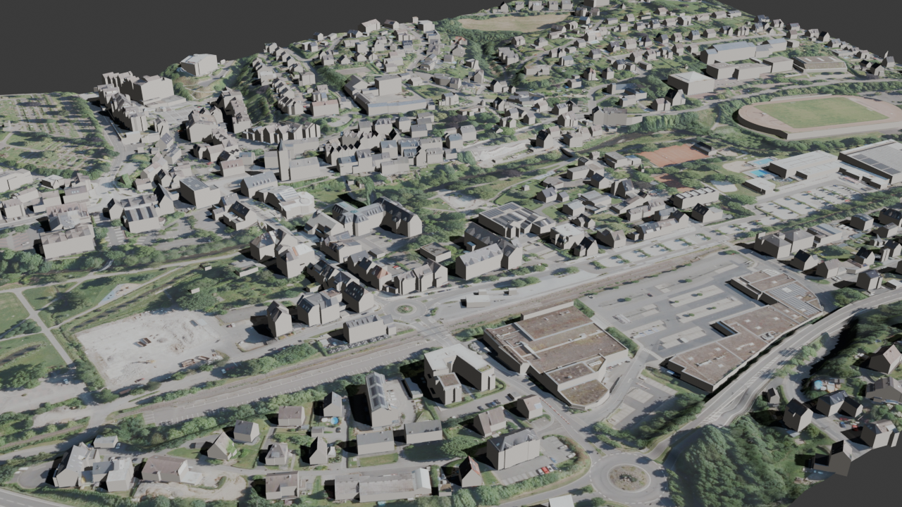
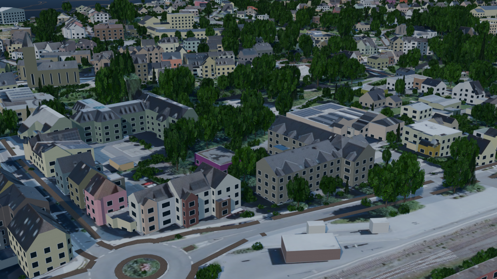
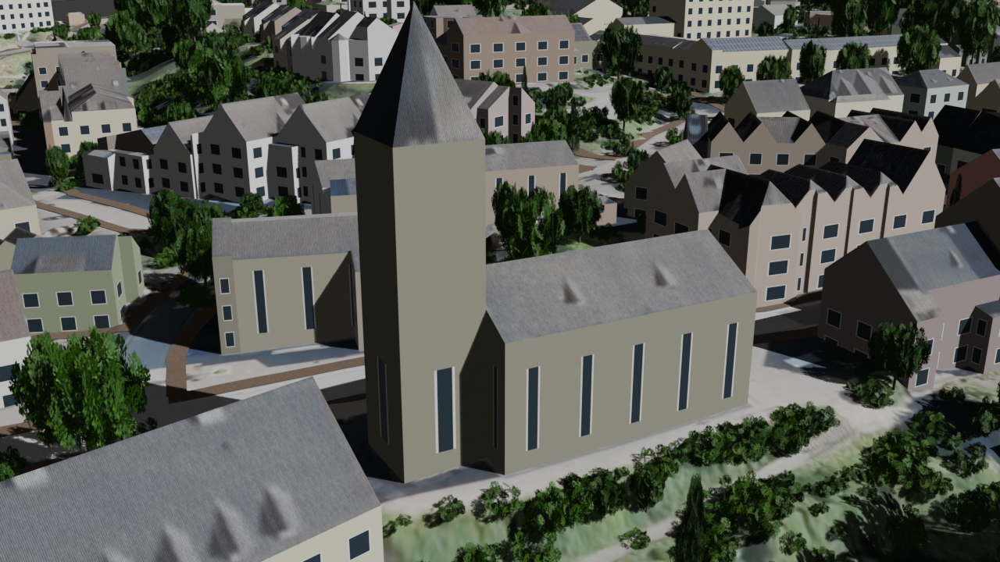

# Wiehl in 3D — a real German town rebuilt from open data

**EN** · Python scripts that rebuild the town of Wiehl (Oberbergischer Kreis, NRW) and its surroundings in Blender from free government data, then cut the result into tiles for a Unity game ([Dexstand](https://github.com/IvanHarhan/dexstand)). Terrain, every building, roads with markings, trees, street lamps, water — generated, not modelled by hand. Later extended along the A4 Autobahn all the way to the centre of Köln.

**DE** · Python-Skripte, die die Stadt Wiehl (Oberbergischer Kreis, NRW) samt Umgebung aus freien Geodaten des Landes NRW in Blender nachbauen und das Ergebnis in Kacheln für ein Unity-Spiel ([Dexstand](https://github.com/IvanHarhan/dexstand)) zerlegen. Gelände, alle Gebäude, Straßen mit Markierungen, Bäume, Laternen, Gewässer – automatisch erzeugt, nicht von Hand modelliert. Später entlang der A4 bis in die Kölner Innenstadt erweitert.



| | |
|---|---|
|  |  |

## Data sources

- **NRW open data (Geobasis NRW, dl-de/zero-2.0):** DGM1 terrain (1 m), DOM1 surface model, DOP10 orthophotos (10 cm), LoD2 3D buildings
- **OpenStreetMap (ODbL):** roads, parking, bus stops, lamps, fences, railway, shops, water, house numbers
- Sketchfab cars (CC-BY) for parked cars and traffic

## Pipeline

```
fetch_tiles.py ─► prep_region.py ─► prep_veg_region.py ─► fetch_osm_region.py
 (NRW 1 km tiles)  (crop, reproject)  (trees: DOM−DGM + NDVI)  (Overpass API)
                                   │
                                   ▼
              build_blend.py  (Blender, headless)
                ├─ wall_shader.py       facades: plaster/brick, windows, doors, shop fronts
                ├─ building_details.py  building roles from OSM (shops, schools, church…)
                ├─ build_extras.py      trees/bushes via geometry nodes
                ├─ build_streets.py     asphalt, markings, zebra crossings, kerbs, Autobahn lanes
                ├─ build_props.py       lamps, bus shelters, hedges, fences, guard rails, rails
                ├─ build_water.py       rivers, lakes
                └─ busbf.py, rewe.py, landmarks.py   hand-tuned local landmarks
                                   │
                                   ▼
              export_region.py ─► 500 m cells as FBX + orthophoto crops ─► Unity asset bundles
              make_minimap.py  ─► in-game map
```

- `wiehl_data/` — the town itself and the Blender build steps
- `region_data/` — the surrounding region (download, preparation, minimap)
- `a4/` — the A4 corridor and Köln, built in chunks (`run_chunk.ps1`, `redo_full.ps1` run everything unattended)
- `cars/` — glTF cars → light FBX for Unity
- `live/` — a live link: Blender runs every script dropped into a folder, used to edit the open scene from outside

## Notes

The Blender files themselves (0.1–0.9 GB each) and the downloaded tiles (~20 GB) are not in the repository; the scripts recreate them. Paths in the scripts point at my machine (`A:\blender_work`).
